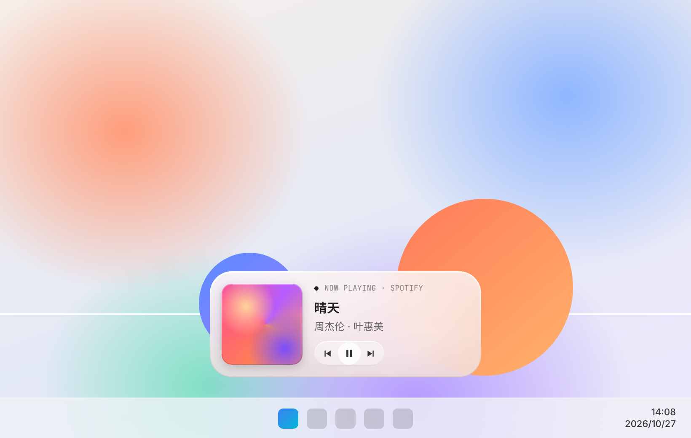

# Coverline

Windows 桌面上的「正在播放」小组件。封面、曲名、艺人安静地待在桌面上，鼠标移上去才出现上一首 / 播放暂停 / 下一首。Spotify、Apple Music for Windows、浏览器里的网页播放器，只要会出现在 Windows 音量浮窗里，都能显示。

A now-playing widget for the Windows desktop: album art, title and artist sit quietly on your desktop, with previous / play-pause / next appearing on hover. Works with anything that reports to Windows' media controls — Spotify, Apple Music for Windows, browsers and more.

> 灵感来自 Mac 应用 [Sleeve](https://replay.software/sleeve)（Replay Software）。Coverline 是从零编写的独立开源项目，与 Sleeve 及其开发者没有任何关联，也没有使用其代码或素材。
> Inspired by Sleeve for Mac by Replay Software. Coverline is an independent, open-source implementation written from scratch and is not affiliated with Sleeve or its developer.



<sub>效果预览（HTML/CSS 按 WPF 实现的同一组尺寸与颜色参数制作的示意图，非 Windows 实机截图）· Preview mock built from the same sizes and colours as the WPF code, not a Windows screenshot. 深色版 Dark: [docs/liquid-glass-preview-dark.png](docs/liquid-glass-preview-dark.png)</sub>

## 液态玻璃 Liquid Glass（v0.2 默认主题）

- **真模糊**：Windows 11 22H2+ 用 DWM 系统亚克力（`DWMWA_SYSTEMBACKDROP_TYPE`），Windows 10 用 accent 亚克力模糊（`SetWindowCompositionAttribute`），都不可用时退回不透明面板。
- **玻璃层次**：极淡白色着色、上亮下暗的光线渐变、1px 斜面内描边（上沿亮、下沿暗）、左上角弧形镜面高光、26px 大圆角；封面做成内嵌玻璃（同心圆角 + 细描边），封面主色以低透明度渗进玻璃。
- **文字永远清楚**：深 / 浅色跟随 Windows「默认应用模式」——浅色模式是浅玻璃 + 深色字，深色模式是深玻璃 + 白字；文字区背后加一层无边缘的柔光 scrim，花哨壁纸上也能读。
- **玻璃胶囊控制**：上一首 / 播放暂停 / 下一首放在一枚小玻璃胶囊里，悬停有柔光，按下轻微缩小再弹回。
- **尊重系统设置**：Windows「透明效果」关闭时自动改为高对比不透明面板；切换深浅色或透明效果后即时更新。
- 托盘菜单「玻璃背景」可手动选：自动 / 系统亚克力 / 经典模糊 / 不透明。

**Liquid Glass (default in v0.2)**: real blur behind the widget (DWM system acrylic on Windows 11 22H2+, accent acrylic on Windows 10, opaque panel otherwise), a faint white tint, light falling from the top edge, a 1px bevel rim (bright top, dark bottom), a soft specular arc in the top-left corner and 26px corners. The artwork sits inset in the glass and its average colour tints the glass slightly. Type follows the Windows app mode (light glass + dark type, or dark glass + white type) with a soft scrim behind the words, so it stays legible on any wallpaper. Controls live in a small glass capsule with a hover glow and a gentle press-and-spring. Turning off Windows transparency effects switches to a high-contrast opaque panel. Tray → Glass backdrop lets you force Auto / System acrylic / Classic blur / Opaque.

## 功能

- **读取系统正在播放**：通过 Windows 的系统媒体传输控件（SMTC，`GlobalSystemMediaTransportControlsSessionManager`）读取当前曲目、封面和播放状态；没有播放时显示「此刻安静」的空闲状态
- **桌面小组件**：无边框，默认贴在桌面层（在其他窗口下方），可选置顶；首次出现在主屏幕底部居中、任务栏上方，避开左右两侧的桌面图标
- **悬停控制**：鼠标移到组件上才显示上一首 / 播放暂停 / 下一首，不用时保持干净
- **换歌淡入淡出**：封面和文字在切歌时平滑交叉淡化
- **随意摆放**：按住拖动，拖过之后位置自动记住；托盘「重置位置」回到底部居中
- **托盘菜单**（右键托盘图标或组件本身）：
  - 主题：**液态玻璃**（默认）/ **编辑部**（纸色卡片、衬线标题、等宽小标签、一个橙色点缀）/ **暗色玻璃**（随封面变色的磨砂深色卡片）/ **纯封面**
  - 玻璃背景（仅液态玻璃）：自动 / 系统亚克力 / 经典模糊 / 不透明
  - 尺寸：小 / 中 / 大
  - 布局：封面 + 文字 / 仅封面 / 仅文字
  - 悬停时显示播放控制、置顶显示、开机自动启动、重置位置、退出
  - 当前版本、检查更新、自动更新开关（v0.3+）
- 单击托盘图标显示 / 隐藏组件
- 设置保存为 JSON：`%AppData%\Coverline\settings.json`

## 下载与运行

在 [Releases](../../releases) 下载 `Coverline-Windows-vX.Y.Z.zip`，解压后运行 `Coverline.exe`。程序常驻托盘，无需安装。需要 Windows 10 1809 或更高版本 / Windows 11（系统自带 .NET Framework 4.8）。

## 自动更新 Auto update（v0.3+）

- 启动 30 秒后检查一次，之后每 6 小时检查一次本仓库的 [Releases](../../releases)（包括预发布版本）。
- 发现新版本后在后台下载到 `%LocalAppData%\Coverline\updates\`，用同一 Release 里的 `SHA256SUMS.txt` 校验，哈希不一致就丢弃。
- **空闲时安装**：没有在播放音乐、鼠标也不在组件上时，Coverline 会静默退出、替换文件（旧版备份为 `Coverline.old.exe`，失败自动回滚）并重新启动；重启后托盘气泡提示「已更新到 vX.Y.Z」。正在播放时会一直等到下次空闲。
- 托盘菜单：**检查更新**（立即检查并用气泡告诉你结果，下载好后点气泡可立即重启更新）、**自动更新**开关（默认开启；关闭后不再后台检查，手动检查仍可用）、当前版本号。
- 如果 Coverline 放在不可写的目录（例如 `C:\Program Files`），不会请求管理员权限，只会弹出通知并打开 Releases 页面，请手动下载。建议把 Coverline 放在自己的文件夹里，例如 `%LocalAppData%\Programs\Coverline`。
- 日志：`%LocalAppData%\Coverline\update.log`。网络不可用、超时或 GitHub 限流时静默跳过，下次再试。
- **v0.2.0 及更早的版本没有自动更新**：请手动下载一次 v0.3.0 覆盖旧文件，之后的版本都会自动更新。

**Auto update (v0.3+)**: Coverline checks this repo's Releases (prereleases included) 30 seconds after launch and every 6 hours, downloads the new zip to `%LocalAppData%\Coverline\updates\`, verifies it against `SHA256SUMS.txt`, and installs it when idle — nothing playing and the pointer not on the widget — by quitting, swapping the files (old exe kept as `Coverline.old.exe`, rolled back on failure) and relaunching. You get a "Updated to vX.Y.Z" balloon afterwards. Tray → Check for updates / Auto update (on by default). If the folder isn't writable (e.g. Program Files) it never asks for admin rights; it notifies you and opens the Releases page instead. Log: `%LocalAppData%\Coverline\update.log`. **v0.2.0 and earlier can't update themselves: download v0.3.0 once by hand; updates are automatic from then on.**

## 构建

```powershell
cd windows
dotnet build -c Release
```

## 改名

产品名集中在 `windows/src/AppInfo.cs` 的 `AppInfo.Name`。改名时另外同步两处：`windows/Coverline.csproj` 里的 `AssemblyName`（以及项目文件名），和 `.github/workflows/build.yml` 顶部的 `APP`。

## 已知限制

- 「贴在桌面层」是把窗口放在所有窗口最下方；按 Win+D 显示桌面时组件会和其他窗口一起被收起。
- 只有向 Windows 媒体控件报告信息的播放器才能显示；少数播放器不提供封面或不支持上一首。
- 标题衬线字体优先使用 Noto Serif SC / 思源宋体，未安装时退回 Georgia + 宋体。
- 目前位置按主显示器坐标记忆；拔掉外接显示器后，如果组件不在可见区域会自动回到底部居中。
- 液态玻璃为了让 DWM 在窗口背后画模糊，使用普通（非分层）窗口 + 圆角窗口区域：因此没有外投影，大圆角边缘在 100% 缩放下可能有轻微锯齿；Windows 10 的 accent 亚克力在拖动窗口时可能略有延迟。
- 液态玻璃的深浅色跟随系统「应用模式」，不是逐像素检测壁纸亮度；若某张壁纸上不满意，可在托盘「玻璃背景」改为「不透明」或切换系统深浅色。
- 系统亚克力在部分 Windows 11 版本上对不活动窗口可能显示为纯色；遇到时在「玻璃背景」选「经典模糊」。
- 自动更新通过隐藏的 PowerShell 脚本替换文件；若组策略禁止运行 PowerShell，更新会失败并保留旧版本，请手动下载。新下载的 exe 首次运行时，Windows SmartScreen 可能提示「未知发布者」（程序未签名）。
- Liquid Glass uses a non-layered window with a rounded region so DWM can blur behind it: no outer shadow, slight corner aliasing at 100% scaling, and Windows 10 accent acrylic can lag while dragging. Light/dark follows the Windows app mode rather than sampling the wallpaper.

## v0.1 「空白卡片」问题 / The v0.1 blank-card bug

v0.1 在 QQ 音乐等播放器上可能只显示封面、文字区一片空白：这些播放器切歌时会连发几次更新（先曲名、再封面、再播放状态），文字淡出动画的完成回调发现已有更新的快照就直接返回，而新快照文字相同、不会再触发淡入，于是标题、艺人和标签被停在透明度 0。v0.2 已修复（任何时候只跑一个淡出，结束时总是用最新内容淡回）。同时编辑部主题的纸色卡片改为完全不透明，桌面图标不会再透出来。

In v0.1, players that publish a burst of updates (QQ Music: title, then artwork, then playback state) could leave the title, artist and label stuck at opacity 0. Fixed in v0.2.

## License

MIT
